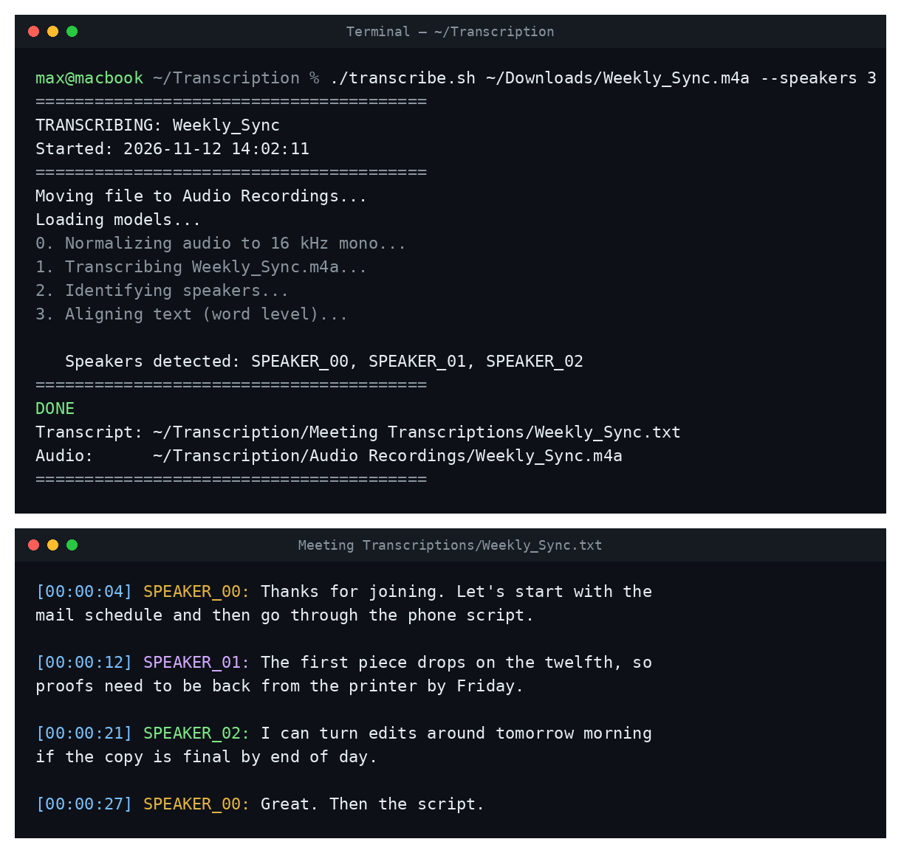

# Local Meeting Transcriber

Turn a meeting recording into a speaker-labeled transcript with one command, without the audio ever leaving your Mac.



*Example run on a made-up recording. Names and dialogue are illustrative.*

## Why I built it

I wanted searchable notes from long client calls without uploading confidential conversations to a third-party transcription service. This runs entirely on Apple Silicon: [MLX Whisper](https://github.com/ml-explore/mlx-examples/tree/main/whisper) for transcription and [pyannote](https://github.com/pyannote/pyannote-audio) for working out who is speaking.

## How it works

```
./transcribe.sh ~/Downloads/meeting.m4a
   │
   ├─ moves the original into  Audio Recordings/   (never re-encoded)
   ▼
process_meeting.py
   ffmpeg        → 16 kHz mono copy in a temp folder
   MLX Whisper   → words with timestamps
   pyannote      → who spoke when
   merge         → each word goes to the speaker it overlaps most,
                   new paragraph after a 3-second pause
   ▼
Meeting Transcriptions/meeting.txt    readable transcript
Meeting Transcriptions/meeting.json   same lines with exact timings
```

Everything (scripts, Python environment, recordings and transcripts) lives in this one folder. The only thing kept outside it is your Hugging Face token, in `~/.hf_token`, so it can never be committed by accident.

## Setup (macOS, Apple Silicon)

1. **Get the code** and put the folder wherever you like (these steps assume `~/Transcription`):

   ```bash
   git clone https://github.com/maximusnobes/meeting-transcriber.git ~/Transcription
   ```

2. **Get Hugging Face access** for the speaker model (free):
   - Accept the terms on [pyannote/speaker-diarization-3.1](https://huggingface.co/pyannote/speaker-diarization-3.1) and [pyannote/segmentation-3.0](https://huggingface.co/pyannote/segmentation-3.0).
   - Create a **Read** token at [huggingface.co/settings/tokens](https://huggingface.co/settings/tokens).

3. **Run the setup script.** It installs ffmpeg and [uv](https://github.com/astral-sh/uv) with Homebrew, builds a Python 3.12 environment in `venv/`, asks you to paste your token (input is hidden), and checks that everything works:

   ```bash
   bash ~/Transcription/setup.sh
   ```

   Every check prints `OK` or `FAIL`, and the full output is saved to `setup.log`. You'll need [Homebrew](https://brew.sh) installed first.

## Usage

```bash
cd ~/Transcription
./transcribe.sh ~/Downloads/MyMeeting.m4a
```

The first run downloads the models (a few GB) to `~/.cache/huggingface`; after that, everything runs offline apart from a quick access check on the gated speaker model.

Useful options (anything after the file name is passed through):

| Option | What it does |
| --- | --- |
| `--speakers 3` | Exact number of speakers, if you know it |
| `--min-speakers` / `--max-speakers` | Bounds for speaker detection (default 2–8) |
| `--names "SPEAKER_00=Alex,SPEAKER_01=Sam"` | Replace speaker labels with real names |
| `--language auto` | Detect the language instead of assuming English |
| `--prompt "Acme, Q3, OKR"` | Vocabulary hint for names and jargon |

For vocabulary you use all the time, put a short comma-separated list in `vocab.txt` in this folder and it's applied to every run.

## Design notes

- **Sensible speaker bounds.** Clustering is limited to 2–8 speakers by default, which avoids pyannote's two common failures: inventing speakers out of background noise and merging everyone into one.
- **Fewer hallucinations.** Whisper's `condition_on_previous_text` is turned off, which prevents the repeated-phrase loops it tends to fall into on long recordings.
- **Safe with your files.** The original recording is moved, never modified, and a duplicate file name is archived with a timestamp rather than overwritten.
- **Pinned versions.** `pyannote.audio` 3.x checkpoints don't load on PyTorch 2.6+, so `requirements.txt` pins compatible versions.

## Optional: transcribe automatically

`watch_downloads.sh` can run in the background and transcribe any `.m4a` that lands in `~/Downloads`, with a macOS notification when each one finishes. It waits for downloads to complete and never runs two jobs at once. To turn it on, edit `com.example.transcribe-watch.plist` (replace `YOUR_USERNAME`), then:

```bash
cp com.example.transcribe-watch.plist ~/Library/LaunchAgents/
launchctl load ~/Library/LaunchAgents/com.example.transcribe-watch.plist
```

To turn it off again: `launchctl unload ~/Library/LaunchAgents/com.example.transcribe-watch.plist`

## Project layout

```
transcribe.sh               the command you run
process_meeting.py          transcription, speaker detection, output
setup.sh                    one-time install and checks
watch_downloads.sh          optional background watcher
com.example.transcribe-watch.plist   launchd config for the watcher
requirements.txt            pinned Python packages
Audio Recordings/           archived originals      (created on first run, git-ignored)
Meeting Transcriptions/     transcripts             (created on first run, git-ignored)
```

## License

MIT
